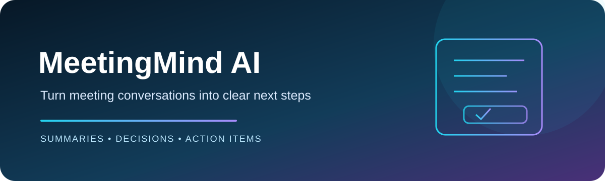
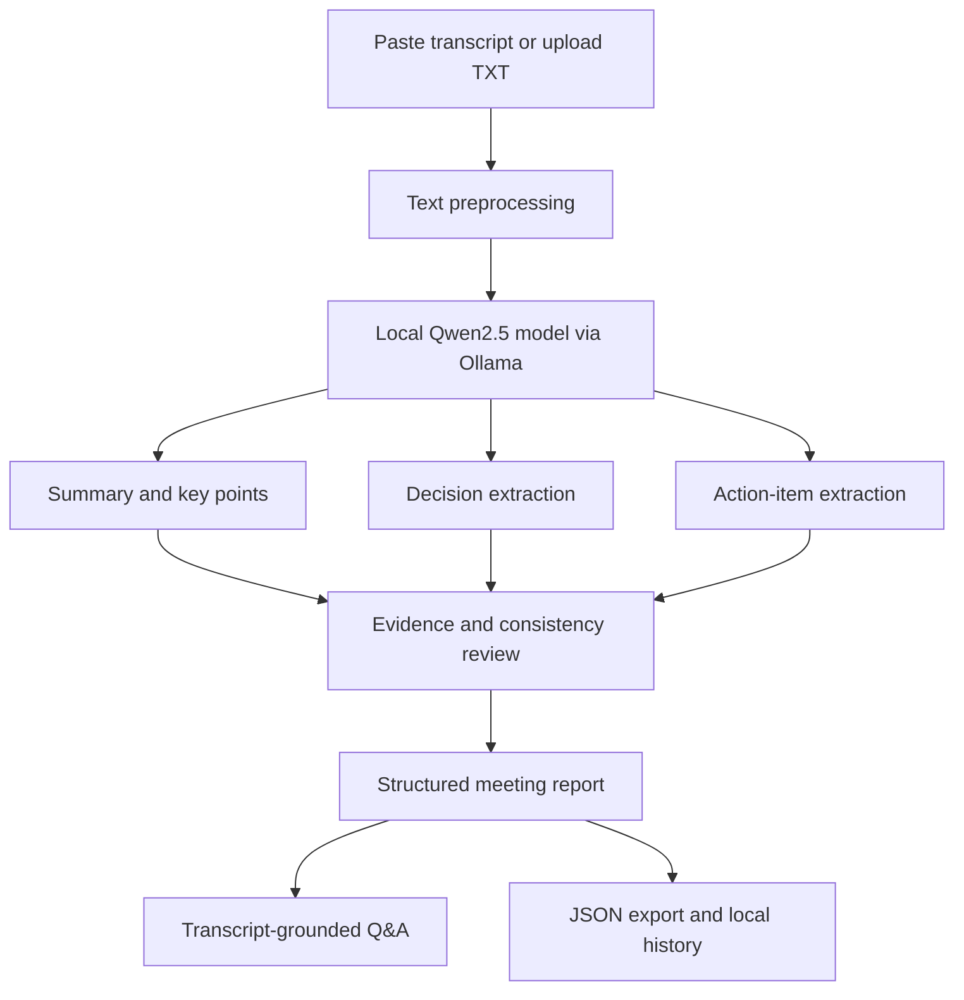

# MeetingMind AI
<p align="center"></p>

<p align="center">
  
  
  
  
  
</p>

<p align="center"><b>From conversations to clear next steps.</b><br/>A local-first GenAI assistant for meeting summaries, decisions and action tracking.</p>

## 🎯 The problem it solves
Meeting notes are often long, scattered and difficult to follow up. MeetingMind AI transforms a transcript into a structured report that makes important information easier to review and act on.

## ✨ Key capabilities
| Capability | Output |
|---|---|
| 📄 Transcript input | Paste meeting text or upload a `.txt` file |
| 📝 Smart summary | Concise overview and key discussion points |
| 📌 Decision tracking | Decisions identified from the transcript |
| ✅ Action-item extraction | Tasks, owners and deadlines |
| ❓ Open questions | Items that still need clarification |
| 🔍 Evidence review | Inspect transcript evidence for extracted details |
| 💬 Meeting Q&A | Ask questions grounded in the supplied transcript |
| 💾 Export & history | Keep local history and download JSON reports |

## 🧠 Agent workflow


## 🧰 Tech stack
| Area | Technology |
|---|---|
| Language | Python |
| Interface | Streamlit |
| Local LLM runtime | Ollama |
| Model | Qwen2.5 |
| Structured report fields | Pydantic-ready data |
| Optional database | MongoDB |
| Dataset / evaluation | QMSum, ROUGE |

## ⚙️ Run locally (macOS)
**1. Clone and install dependencies**
```bash
git clone https://github.com/likhithds1si23cs099-bit/MeetingMind_AI.git
cd MeetingMind_AI
python3 -m venv .venv
source .venv/bin/activate
pip install -r requirements.txt
```

**2. Install and start Ollama**
Install from [ollama.com/download](https://ollama.com/download), then run:

```bash
ollama pull qwen2.5:3b
ollama serve
```

**3. Start the application** (in a second terminal opened in the project folder):

```bash
source .venv/bin/activate
streamlit run app.py
```

Open **http://localhost:8501** in your browser.

## 🪄 Try the application
1. Open **Analyze Meeting** from the sidebar.
2. Enter a meeting title.
3. Paste a transcript or upload a `.txt` file.
4. Select **Generate meeting report**.
5. Review the summary, decisions, action items and open questions.
6. Open **Ask Meeting** to ask a question about the transcript.
7. Download the report as JSON.

## 📊 Dataset and evaluation
The project includes scripts for preparing a QMSum sample and running a baseline ROUGE evaluation.

```bash
python dataset_prepare.py --limit 1000
python evaluation.py --input data/qmsum_sample.jsonl --limit 100
```

Sources: [QMSum project](https://github.com/Yale-LILY/QMSum) · [QMSum dataset on Hugging Face](https://huggingface.co/datasets/pszemraj/qmsum-cleaned)

**Evaluation note:** ROUGE measures summary text overlap. It does not by itself verify whether extracted decisions, owners or deadlines are factually correct.

## 🔒 Privacy, limitations and responsible use
- The app is designed for local-first processing with Ollama.
- The rule-based fallback is a preview mode, not a full LLM response.
- Always verify generated decisions, owners and deadlines against the original transcript.
- This prototype does not automatically send emails, assign tasks or record meetings.
- Do not upload confidential transcripts to services without permission.

---
<p align="center"><b>Make every meeting easier to understand — and easier to follow through.</b></p>
